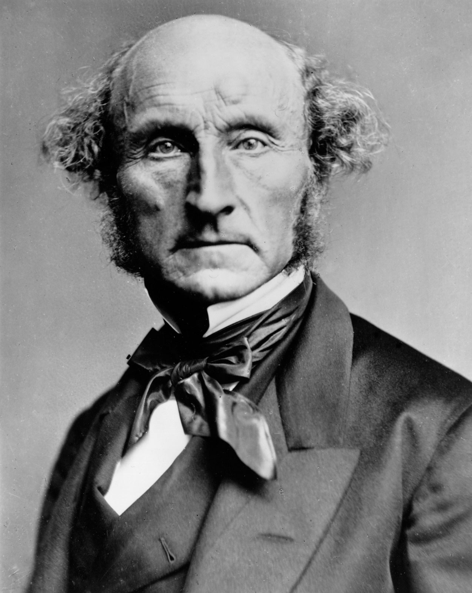
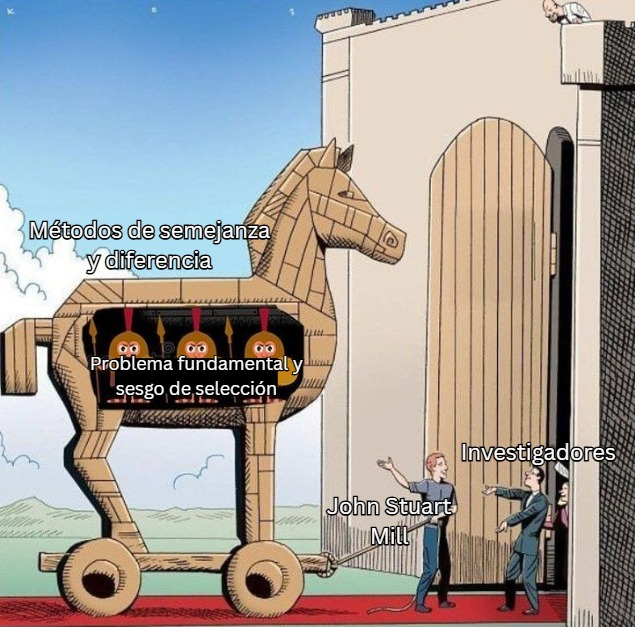

## [La causalidad y el problema fundamental]{style="color:#78acd6;"} 

::::: columns
::: {.column width="60%"}
-   [**Problema fundamental**]{style="color:#c97373;"} de la Inferencia causal (Holland, 1986).
-   En ciencias sociales no se pueden observar dos resultados en un mismo sujeto a la vez.
-   El enfoque cualitativo busca explicar la causa de los efectos en casos concretos.
:::

::: {.column width="40%"}
<br> <br> 
:::
:::::

## [Método comparado]{style="color:#78acd6;"}

-  [**Arend Lijphart:**]{style="color:#c97373;"} la comparación como reemplazo de la experimentación
- [**Importante:**]{style="color:#c97373;"} la selección de casos

{fig-align="center" width="30%"}

------------------------------------------------------------------------

## [Método de la semejanza]{style="color:#78acd6;"}

-   Casos distintos con un mismo resultado

::: {layout-ncol="2"}


:::

------------------------------------------------------------------------

## [Ejemplo con Polity V]{style="color:#78acd6;"}

-   [**Casos:**]{style="color:#c97373;"} Chile y Japón 2018
-   Diferencias culturales e históricas, pero los dos son democracias plenas

```{r}
#| echo: false
#| warning: false

library(readxl)
library(dplyr)
library(knitr)

datos_polity <- read_excel("p5v2018d.xls")

tabla_semejanza <- datos_polity %>%
  filter(country %in% c("Chile", "Japan"), eyear == 2018 | eyear == 9999) %>%
  select(country, eyear, democ, autoc, polity) %>%
  mutate(country = ifelse(country == "Japan", "Japón", country))

kable(tabla_semejanza)
```

------------------------------------------------------------------------

## [Método de la diferencia]{style="color:#78acd6;"}

-   Casos parecidos con un resultado diferente

::: {layout-ncol="2"}


:::

## [Ejemplo con Polity V]{style="color:#78acd6;"}

-   [**Casos:**]{style="color:#c97373;"} Uruguay y Venezuela
-   Tienen similitudes regionales e históricas, pero no resultados políticos similares

```{r}
#| echo: false
#| warning: false

tabla_diferencia <- datos_polity %>%
  filter(country %in% c("Uruguay", "Venezuela"), eyear == 2018 | eyear == 9999) %>%
  select(country, eyear, democ, autoc, polity)

kable(tabla_diferencia)
```

## [Sesgo de selección]{style="color:#78acd6;"}

-   Barbara Geddes (1990) dice que seleccionar casos basándose solo en el resultado positivo de la variable dependiente genera inferencias erróneas

<center>{width="40%"}</center>

## [Conclusión]{style="color:#78acd6;"}

-   Los métodos de Mill son insuficientes por el problema fundamental y el riesgo de sesgo

-   Comparación cruzada entre casos combinada con el rastreo de procesos dentro de los casos

    <center>

    ## {width="39%"}

## [Referencias]{style="color:#78acd6;"}  {.scrollable}

::: smaller
-   **Collier, David** (1992). *"El método comparativo"*. Revista Uruguaya de Ciencia Política
-   **Geddes, Barbara** (1990). *"How the Cases You Choose Affect the Answers You Get: Selection Bias in Comparative Politics"*. Political Analysis
-   **George, Alexander L. y Andrew Bennett** (2005). *Case Studies and Theory Development in the Social Sciences*. MIT Press
-   **Holland, Paul W.** (1986). *"Statistics and Causal Inference"*. Journal of the American Statistical Association
-   **King, Gary, Robert O. Keohane y Sidney Verba** (2000). *El diseño de la investigación social: La inferencia científica en los estudios cualitativos*. Alianza Editorial
-   **Mahoney, James y Gary Goertz** (2006). *"A Tale of Two Cultures: Contrasting Quantitative and Qualitative Research"*. Political Analysis
-   **Marshall, M. G., & Gurr, T. R.** (2020). *Polity5 Project: Political Regime Characteristics and Transitions, 1800-2018* [Base de datos]. Center for Systemic Peace. https://www.systemicpeace.org/inscrdata.html
-   **Pérez-Liñán, Aníbal** (2010). *"El método comparativo y el análisis de configuraciones causales"*. Revista Latinoamericana de Política Comparada
-   **Skocpol, Theda y Margaret Somers** (1980). *"The Uses of Comparative History in Macrosocial Inquiry"*. Comparative Studies in Society and History
:::
